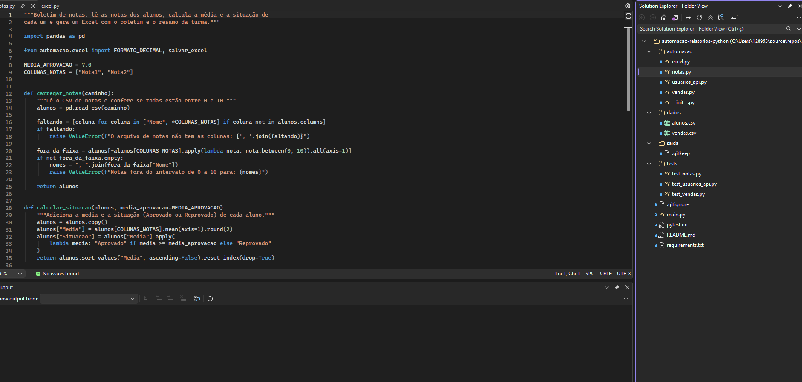

# Automação de relatórios em Excel com Python

Conjunto de automações em Python que transformam dados brutos (arquivos CSV e uma API REST) em relatórios Excel organizados e formatados, prontos para enviar ou analisar. É o tipo de tarefa repetitiva que costuma ser feita à mão em planilhas no dia a dia de uma empresa.



| Automação | Entrada | O que gera |
|---|---|---|
| **Relatório de vendas** | CSV com as vendas | Faturamento por produto (com participação no total), faturamento por mês e o detalhe de cada venda |
| **Boletim de notas** | CSV com as notas dos alunos | Média e situação (aprovado ou reprovado) de cada aluno e um resumo da turma |
| **Usuários de uma API** | API pública [JSONPlaceholder](https://jsonplaceholder.typicode.com/users) | Lista de usuários com nome, e-mail, cidade e empresa, com filtro opcional por cidade, e a contagem por cidade |

Todos os relatórios saem com o cabeçalho em destaque, a primeira linha congelada, as colunas na largura do conteúdo e os valores formatados (moeda, percentual e decimais).

## Tecnologias

- **Python**
- **Pandas**: leitura de CSV e JSON, cálculos, agrupamentos e exportação para Excel
- **Requests**: consumo de API REST
- **OpenPyXL**: formatação das planilhas
- **Argparse**: interface de linha de comando
- **Pytest**: testes automatizados, com a API simulada para não depender de internet

## Estrutura do projeto

```
automacao-relatorios-python/
├── automacao/
│   ├── vendas.py          # relatório de vendas
│   ├── notas.py           # boletim de notas
│   ├── usuarios_api.py    # consumo da API e relatório de usuários
│   └── excel.py           # função compartilhada que salva e formata o Excel
├── dados/
│   ├── vendas.csv         # dados de exemplo (fictícios)
│   └── alunos.csv         # dados de exemplo (fictícios)
├── saida/                 # onde os relatórios são gerados
├── tests/                 # testes de cada automação
├── main.py                # ponto de entrada: escolhe qual automação rodar
├── requirements.txt
└── pytest.ini
```

## Como executar

Testado com Python 3.13. Os comandos abaixo são para Windows. No Linux ou macOS, ative o ambiente com `source .venv/bin/activate`.

```bash
git clone https://github.com/moreiralivia80-oss/automacao-relatorios-python.git
cd automacao-relatorios-python

python -m venv .venv
.venv\Scripts\activate
pip install -r requirements.txt
```

### Relatório de vendas

```bash
python main.py vendas
```

```
Vendas processadas: 35
Faturamento total: R$ 42.660,00
Produto com maior faturamento: Monitor

  Monitor      R$ 24.000,00  (56,3%)
  Webcam       R$ 10.780,00  (25,3%)
  Mouse         R$ 3.280,00  (7,7%)
  Teclado       R$ 2.800,00  (6,6%)
  Headset       R$ 1.800,00  (4,2%)

Relatório salvo em: saida\relatorio_vendas.xlsx
```

O Excel gerado tem três abas: **Por produto**, **Por mês** e **Vendas**.

### Boletim de notas

```bash
python main.py notas
python main.py notas --media 6     # muda a média mínima de aprovação (padrão: 7)
```

```
  Juliana    média  9,75  Aprovado
  Ana        média  8,50  Aprovado
  ...
  Rafael     média  4,75  Reprovado

Total de alunos: 8
Aprovados: 5
Reprovados: 3
Taxa de aprovação (%): 62,5
Média da turma: 7,06
```

O Excel gerado tem duas abas: **Boletim** e **Resumo**.

### Usuários da API

Precisa de conexão com a internet.

```bash
python main.py usuarios                       # todos os usuários
python main.py usuarios --cidade Gwenborough  # só os de uma cidade
```

O Excel gerado tem duas abas: **Usuarios** e **Por cidade**.

### Usando os seus próprios arquivos

As automações de vendas e notas aceitam outros arquivos, desde que tenham as mesmas colunas dos exemplos em `dados/`:

```bash
python main.py vendas --entrada C:\caminho\minhas_vendas.csv --saida C:\caminho\relatorio.xlsx
```

Use `python main.py <automação> --help` para ver todas as opções.

### Rodar os testes

```bash
pytest
```

## Tratamento de erros

As automações validam os dados antes de gerar o relatório e mostram uma mensagem clara em vez de um erro do Python:

- arquivo de entrada inexistente ou sem as colunas esperadas;
- vendas com quantidade ou preço menor ou igual a zero (a mensagem indica a linha do CSV);
- notas fora do intervalo de 0 a 10 (a mensagem indica o aluno);
- falha de conexão, tempo esgotado ou erro HTTP na API;
- relatório que não pode ser salvo porque está aberto no Excel.

## O que aprendi

- Usar o Pandas para **automatizar tarefas de planilha**: cálculos por linha, agrupamentos (`groupby`), ordenação e exportação para Excel com várias abas.
- **Consumir uma API REST** com Requests e transformar JSON com campos aninhados em tabela (`json_normalize`).
- Tratar erros de rede com `timeout` e `raise_for_status`, e **validar os dados de entrada** antes de processar.
- Organizar scripts soltos num projeto com **funções reutilizáveis**, **módulos** e uma **interface de linha de comando**.
- Escrever **testes automatizados**, inclusive simulando a resposta de uma API com `monkeypatch`.

## Autora

**Lívia Moreira Teixeira**, estudante de Análise e Desenvolvimento de Sistemas.
[LinkedIn](https://www.linkedin.com/in/liviamoreira-software/) · [GitHub](https://github.com/moreiralivia80-oss)
